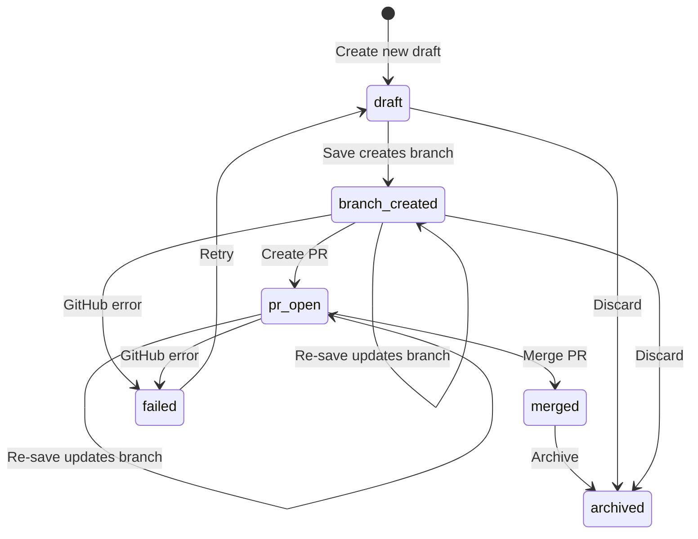
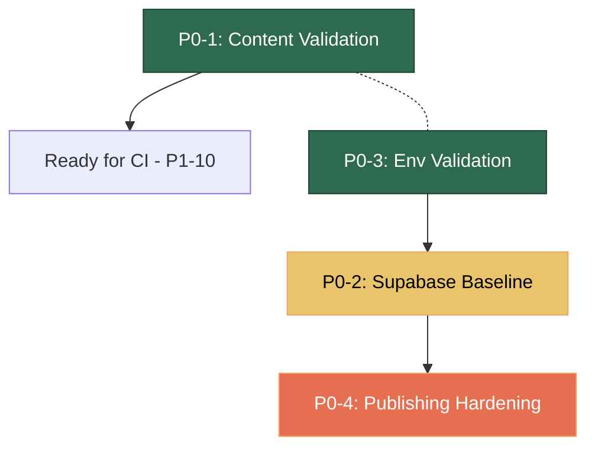

# P0 — Foundation & Correctness: Implementation Plan

> [!NOTE]
> This plan covers all four P0 items from [ROADMAP.md](file:///Users/jakeerchilakala/Projects/PersonalSite/jakeer.com/ROADMAP.md#L26-L100). Each item is broken into discrete, reviewable work slices. Items are ordered by dependency: **P0-1 → P0-3 → P0-2 → P0-4**, because the content validator (P0-1) and env validation (P0-3) are independent foundations, the Supabase baseline (P0-2) depends on env validation patterns, and publishing hardening (P0-4) depends on all three.

---

## P0-1 · Content Contract Validation

**Goal:** A single `npm run validate:content` command that catches every frontmatter, slug, ordering, and cross-reference error before build.

### Slice 1A — Validation schemas and runner

| Detail | Value |
|--------|-------|
| **New files** | `scripts/validate-content.ts` |
| **Modified files** | `package.json` (add script) |
| **Dependencies** | `zod` (add as dev dep), existing `gray-matter` |

**What to build:**

1. **Zod schemas** — one per content type, matching the contracts in [CONTEXT.md](file:///Users/jakeerchilakala/Projects/PersonalSite/jakeer.com/CONTEXT.md#L107-L123):

   ```
   WritingFrontmatter  → { title: string, date: string, readTime: string, tags: string[], description: string, featured?: boolean, image?: string, draft?: boolean }
   SnippetFrontmatter  → { title: string, date: string, description: string, lang: string, level: "BEGINNER"|"INTERMEDIATE"|"ADVANCED", tags: string[], draft?: boolean }
   ToolFrontmatter     → { name: string, description: string, category: string, link: string (url), icon: string, draft?: boolean }
   NoteFrontmatter     → { title: string, description: string, readTime: string, topic: string, subtopic: string, order: number, tags: string[], draft?: boolean }
   NoteIndexJson       → { displayOrder?: number, label: string, description: string, icon: string, color: string, principles: { label: string, text: string }[] }
   ```

2. **Validation runner** (`scripts/validate-content.ts`):
   - Walk `content/writing/`, `content/snippets/`, `content/tools/`, and `content/notes/<topic>/`
   - Parse each `.mdx` / `.md` file with `gray-matter`, validate frontmatter against the matching Zod schema
   - For notes: validate `index.json` exists and conforms; validate `topic` field matches directory name
   - Cross-checks:
     - **Duplicate slugs** within the same category
     - **Valid note topics** — `topic` field matches an existing `content/notes/<topic>/` directory
     - **Snippet tag ↔ category** — at least one tag should be a known snippet category slug
     - **Image references** — any `image` field or `` reference to `/assets/` or `/public/assets/` exists on disk
   - Exit code 1 on any error, 0 on success; print file, field, and error message

3. **Package script:**
   ```json
   "validate:content": "npx tsx scripts/validate-content.ts"
   ```

### Slice 1B — Integrate into build and CI

| Detail | Value |
|--------|-------|
| **Modified files** | `package.json` |

- Chain `validate:content` as a `prebuild` script:
  ```json
  "prebuild": "npm run validate:content"
  ```
- This ensures `npm run build` validates content first. CI (P1-10) will inherit this automatically.

### Slice 1C — Tests for the validator

| Detail | Value |
|--------|-------|
| **New files** | `scripts/__tests__/validate-content.test.ts` |

- Unit-test the Zod schemas and cross-check functions with synthetic frontmatter
- Test cases: valid writing, missing `title`, invalid `level` enum, duplicate slug, note with non-existent topic, broken image reference
- Drafts: validate schema but mark them as `(draft)` in output — do not skip validation

### Design decisions

- **Zod over custom parsing**: gives typed validation, reusable schemas, and clear error messages out of the box
- **`tsx` runner**: runs TypeScript directly, no build step, reuses project `tsconfig.json` paths
- **Drafts are validated**: drafts with `draft: true` get schema-checked but are excluded from public listing by the existing `mdx.ts` filter — we validate correctness of drafts too so they don't break when published

---

## P0-3 · Environment Validation & Safe Failure States

**Goal:** Replace `!` non-null assertions on env vars with validated access; public pages never break due to missing admin integrations.

> [!IMPORTANT]
> Doing P0-3 before P0-2 because the Supabase security baseline work will use the new env validation utilities.

### Slice 3A — Env validation module

| Detail | Value |
|--------|-------|
| **New files** | `src/lib/env.ts` |
| **Modified files** | none |

Create a centralized env module:

```typescript
// src/lib/env.ts

/** Validated environment variables — throws at import time with clear diagnostics */
function requireEnv(name: string): string {
  const value = process.env[name];
  if (!value) {
    throw new Error(
      `Missing required environment variable: ${name}. ` +
      `Check .env.local or deployment environment.`
    );
  }
  return value;
}

function optionalEnv(name: string): string | undefined {
  return process.env[name] || undefined;
}

// --- Public (browser-safe) ---
export const SUPABASE_URL = requireEnv("NEXT_PUBLIC_SUPABASE_URL");
export const SUPABASE_PUBLISHABLE_KEY = requireEnv("NEXT_PUBLIC_SUPABASE_PUBLISHABLE_KEY");

// --- Server-only ---
export function getGitHubToken(): string {
  const token = process.env.GITHUB_TOKEN;
  if (!token) {
    throw new Error(
      "GITHUB_TOKEN is not set. GitHub-backed admin actions are unavailable. " +
      "Set this in .env.local for local development."
    );
  }
  return token;
}
```

Key design:
- **Supabase vars** are validated eagerly — they are needed for auth on every admin page load
- **`GITHUB_TOKEN`** is validated lazily via `getGitHubToken()` — only admin actions that touch GitHub call this, so missing token doesn't break public routes
- **Secrets never appear in error messages** — only the variable name is mentioned

### Slice 3B — Replace `!` assertions in Supabase clients

| Detail | Value |
|--------|-------|
| **Modified files** | [`server.ts`](file:///Users/jakeerchilakala/Projects/PersonalSite/jakeer.com/src/lib/supabase/server.ts), [`client.ts`](file:///Users/jakeerchilakala/Projects/PersonalSite/jakeer.com/src/lib/supabase/client.ts), [`middleware.ts`](file:///Users/jakeerchilakala/Projects/PersonalSite/jakeer.com/src/lib/supabase/middleware.ts) |

- Import `SUPABASE_URL` and `SUPABASE_PUBLISHABLE_KEY` from `@/lib/env` instead of using `process.env.…!`
- Remove the three pairs of `!` non-null assertions currently in these files

### Slice 3C — Replace GITHUB_TOKEN assertions in admin actions

| Detail | Value |
|--------|-------|
| **Modified files** | [`actions.ts`](file:///Users/jakeerchilakala/Projects/PersonalSite/jakeer.com/src/app/admin/actions.ts) |

Current code (lines 98-99, 282-283, 315-316, 350, 399, 427-428):
```typescript
const githubToken = process.env.GITHUB_TOKEN;
if (!githubToken) throw new Error("GITHUB_TOKEN missing in .env.local");
```

Replace all six occurrences with:
```typescript
import { getGitHubToken } from "@/lib/env";
// ...
const githubToken = getGitHubToken();
```

This consolidates the error message and guarantees consistency.

### Slice 3D — Tests for env module

| Detail | Value |
|--------|-------|
| **New files** | `src/lib/__tests__/env.test.ts` |

- Test `requireEnv` throws with the variable name when unset
- Test `getGitHubToken` throws when `GITHUB_TOKEN` is unset
- Test secrets are **not** included in error messages
- Test happy path returns correct value

---

## P0-2 · Supabase Database & Storage Security Baseline

**Goal:** Version the `content_drafts` table, `assets` bucket policies, RLS, and generated types so the schema is reproducible and secure.

> [!WARNING]
> Before implementing, we need to confirm the current remote schema. Run `npx supabase db diff` or inspect the dashboard to capture what exists today, then write the migration to match + harden.

### Slice 2A — Initialize Supabase local config

| Detail | Value |
|--------|-------|
| **New files** | `supabase/config.toml` (via `npx supabase init`) |

- Run `npx supabase init` to create the `supabase/` directory
- Configure project ID in `config.toml` (do NOT commit secrets)
- Add `supabase/.temp/` to `.gitignore`

### Slice 2B — Migration: `content_drafts` table + RLS

| Detail | Value |
|--------|-------|
| **New files** | `supabase/migrations/YYYYMMDDHHMMSS_create_content_drafts.sql` |

```sql
-- content_drafts table
create table if not exists public.content_drafts (
  id          uuid primary key default gen_random_uuid(),
  user_id     uuid not null references auth.users(id) on delete cascade,
  category    text not null check (category in ('writing', 'snippets', 'tools', 'notes')),
  title       text not null,
  slug        text not null,
  description text,
  markdown    text,
  metadata    jsonb default '{}'::jsonb,
  branch_name text,
  pr_number   integer,
  is_archived boolean default false,
  created_at  timestamptz default now(),
  updated_at  timestamptz default now()
);

-- Indexes
create index if not exists idx_content_drafts_user_id on public.content_drafts(user_id);
create index if not exists idx_content_drafts_category on public.content_drafts(category);
create index if not exists idx_content_drafts_archived on public.content_drafts(is_archived);

-- RLS
alter table public.content_drafts enable row level security;

-- Users can only see/modify their own drafts
create policy "Users can view own drafts"
  on public.content_drafts for select
  using (auth.uid() = user_id);

create policy "Users can insert own drafts"
  on public.content_drafts for insert
  with check (auth.uid() = user_id);

create policy "Users can update own drafts"
  on public.content_drafts for update
  using (auth.uid() = user_id)
  with check (auth.uid() = user_id);

create policy "Users can delete own drafts"
  on public.content_drafts for delete
  using (auth.uid() = user_id);
```

### Slice 2C — Migration: `assets` Storage bucket + policies

| Detail | Value |
|--------|-------|
| **New files** | `supabase/migrations/YYYYMMDDHHMMSS_create_assets_bucket.sql` |

```sql
-- Create public assets bucket
insert into storage.buckets (id, name, public)
values ('assets', 'assets', true)
on conflict (id) do nothing;

-- Authenticated users can upload
create policy "Authenticated users can upload assets"
  on storage.objects for insert
  with check (
    bucket_id = 'assets'
    and auth.role() = 'authenticated'
  );

-- Authenticated users can update (upsert)
create policy "Authenticated users can update assets"
  on storage.objects for update
  using (bucket_id = 'assets' and auth.role() = 'authenticated')
  with check (bucket_id = 'assets' and auth.role() = 'authenticated');

-- Public read for assets
create policy "Public read access for assets"
  on storage.objects for select
  using (bucket_id = 'assets');

-- Authenticated users can delete their uploads
create policy "Authenticated users can delete assets"
  on storage.objects for delete
  using (bucket_id = 'assets' and auth.role() = 'authenticated');
```

### Slice 2D — Generate TypeScript types

| Detail | Value |
|--------|-------|
| **New files** | `src/lib/supabase/database.types.ts` |
| **Modified files** | `package.json` (add `gen:types` script) |

```json
"gen:types": "npx supabase gen types typescript --local > src/lib/supabase/database.types.ts"
```

- Type the Supabase client with `Database` generic for compile-time safety on `from("content_drafts")`
- Update [`server.ts`](file:///Users/jakeerchilakala/Projects/PersonalSite/jakeer.com/src/lib/supabase/server.ts) and [`client.ts`](file:///Users/jakeerchilakala/Projects/PersonalSite/jakeer.com/src/lib/supabase/client.ts) to use `createServerClient<Database>(...)` and `createBrowserClient<Database>(...)`

### Slice 2E — Security verification queries

| Detail | Value |
|--------|-------|
| **New files** | `supabase/tests/security_verification.sql` |

Write SQL verification queries (to run via dashboard or `supabase db execute`):

- Confirm RLS is enabled on `content_drafts`
- Confirm no `anon` role can read/write `content_drafts`
- Confirm `assets` bucket is public for reads, auth-only for writes
- Confirm no service-role key is referenced in client code (a grep check in CI)

### Pre-requisite check

> [!CAUTION]
> Before applying migrations, we must verify what already exists in the remote Supabase project. **Action needed:**
> 1. Run `npx supabase db diff --linked` to capture current state
> 2. If the `content_drafts` table already exists, write the migration as `CREATE TABLE IF NOT EXISTS` and add columns/policies incrementally
> 3. Review the Supabase dashboard for any existing Storage policies

---

## P0-4 · Idempotent & Recoverable Publishing

**Goal:** The save → branch → PR → merge workflow handles retries, partial failures, duplicates, and stale state gracefully.

### Slice 4A — Deterministic branch naming (eliminate duplicates)

| Detail | Value |
|--------|-------|
| **Modified files** | [`actions.ts`](file:///Users/jakeerchilakala/Projects/PersonalSite/jakeer.com/src/app/admin/actions.ts) |

**Problem:** Current branch naming uses `Date.now()` (line 119):
```typescript
branchName = `content/${payload.category}-${payload.slug}-${Date.now()}`;
```
Repeated saves for the same draft create new branches each time if `branchName` is lost.

**Fix:**
- Tie branch name to the **draft ID**: `content/${category}-${slug}-${draftId}`
- For new drafts: insert into Supabase **first** to get the ID, then create the branch
- For existing drafts: reuse the stored `branch_name`

### Slice 4B — Add draft state machine

| Detail | Value |
|--------|-------|
| **Modified files** | `supabase/migrations/...`, [`actions.ts`](file:///Users/jakeerchilakala/Projects/PersonalSite/jakeer.com/src/app/admin/actions.ts) |
| **New files** | `src/lib/draft-states.ts` |

Add a `status` column to `content_drafts`:

```sql
alter table public.content_drafts
  add column if not exists status text
  default 'draft'
  check (status in ('draft', 'branch_created', 'pr_open', 'merged', 'archived', 'failed'));
```

State transitions:



### Slice 4C — Idempotent PR creation

| Detail | Value |
|--------|-------|
| **Modified files** | [`actions.ts`](file:///Users/jakeerchilakala/Projects/PersonalSite/jakeer.com/src/app/admin/actions.ts) — `createPRForContent()` |

**Current problem** (lines 291-298): calling `pulls.create()` twice for the same branch throws a GitHub API error.

**Fix:**
```typescript
// Before creating, check for existing open PR on this branch
const { data: existingPRs } = await octokit.rest.pulls.list({
  owner, repo,
  head: `${owner}:${branchName}`,
  state: "open",
});

if (existingPRs.length > 0) {
  // Update existing PR title/body instead of creating a duplicate
  const existingPR = existingPRs[0];
  await octokit.rest.pulls.update({
    owner, repo,
    pull_number: existingPR.number,
    title: `Add ${category}: ${title}`,
  });
  return { prNumber: existingPR.number, prUrl: existingPR.html_url };
}
// ... else create new PR
```

### Slice 4D — Verify merge before archiving

| Detail | Value |
|--------|-------|
| **Modified files** | [`actions.ts`](file:///Users/jakeerchilakala/Projects/PersonalSite/jakeer.com/src/app/admin/actions.ts) — `mergePRAction()` |

**Current problem** (lines 322-333): merge is called, then the draft is immediately archived with no check that the merge actually succeeded.

**Fix:**
```typescript
const { data: mergeResult } = await octokit.rest.pulls.merge({ ... });

// Verify the PR is actually merged
const { data: prAfterMerge } = await octokit.rest.pulls.get({
  owner, repo, pull_number: prNumber
});

if (!prAfterMerge.merged) {
  // Update status to failed, don't archive
  await supabase.from("content_drafts")
    .update({ status: "failed", updated_at: new Date().toISOString() })
    .eq("id", id);
  throw new Error("PR merge was not confirmed. Draft marked as failed for retry.");
}

// Now safe to archive
await supabase.from("content_drafts")
  .update({ status: "merged", is_archived: true, updated_at: new Date().toISOString() })
  .eq("id", id);
```

### Slice 4E — Sanitize frontmatter values

| Detail | Value |
|--------|-------|
| **New files** | `src/lib/sanitize.ts` |
| **Modified files** | [`actions.ts`](file:///Users/jakeerchilakala/Projects/PersonalSite/jakeer.com/src/app/admin/actions.ts) — `saveDraftAction()` |

**Current problem** (lines 143-190): title, description, and tags are interpolated directly into YAML frontmatter without escaping. A title containing `"` or `:` would produce invalid YAML.

**Fix:**
```typescript
// src/lib/sanitize.ts
export function escapeYamlString(value: string): string {
  // If it contains special YAML chars, wrap in double quotes with escaping
  if (/[:"'#\[\]{}&*!|>%@`\n]/.test(value)) {
    return `"${value.replace(/\\/g, '\\\\').replace(/"/g, '\\"')}"`;
  }
  return `"${value}"`;
}
```

Apply `escapeYamlString()` to all frontmatter string fields in the generated MDX.

### Slice 4F — Owner-scoped mutations

| Detail | Value |
|--------|-------|
| **Modified files** | [`actions.ts`](file:///Users/jakeerchilakala/Projects/PersonalSite/jakeer.com/src/app/admin/actions.ts) |

**Current problem:** `update` and `delete` operations filter by `id` but not by `user_id`. With RLS (from P0-2), the database will enforce this, but defense in depth:

```typescript
// In every mutation, add .eq("user_id", user.id) alongside .eq("id", id)
await supabase.from("content_drafts")
  .update(dbPayload)
  .eq("id", payload.id)
  .eq("user_id", user.id);  // add this
```

### Slice 4G — Error handling with correlation

| Detail | Value |
|--------|-------|
| **Modified files** | [`actions.ts`](file:///Users/jakeerchilakala/Projects/PersonalSite/jakeer.com/src/app/admin/actions.ts), admin client components |

Wrap GitHub/Supabase operations in structured try/catch blocks that:
1. Set `status = "failed"` on the draft when a GitHub operation fails mid-flow
2. Return a typed error result `{ success: false, error: string, correlationId: string }` instead of throwing raw errors
3. Log the full error server-side with a correlation ID
4. Surface only the user-friendly message + correlation ID to the client

### Slice 4H — Document `force: true` decision

| Detail | Value |
|--------|-------|
| **Modified files** | [`actions.ts`](file:///Users/jakeerchilakala/Projects/PersonalSite/jakeer.com/src/app/admin/actions.ts#L239) |

Current code (line 239-241):
```typescript
await octokit.rest.git.updateRef({
  // ...
  force: true,  // dangerous: overwrites any other commits on the branch
});
```

Since we're now using deterministic branch names tied to drafts, `force: true` is acceptable for draft branches (they're single-author). Document this decision explicitly:

```typescript
// force: true is intentional — draft branches are single-author throwaway branches.
// The admin is the only committer; rebasing onto the latest default branch
// happens when the PR is created, not on every save.
force: true,
```

---

## Summary: Execution order & dependencies



| Phase | Items | Estimated PRs | Key risk |
|-------|-------|--------------|----------|
| **Phase 1** (parallel) | P0-1 (content validation) + P0-3 (env validation) | 2 PRs | None — fully independent |
| **Phase 2** | P0-2 (Supabase baseline) | 1 PR | Must verify remote schema first |
| **Phase 3** | P0-4 (publishing hardening) | 1-2 PRs | Touches the most critical admin workflow; needs careful testing |

### Files touched across all P0 work

| File | P0-1 | P0-2 | P0-3 | P0-4 |
|------|:----:|:----:|:----:|:----:|
| `scripts/validate-content.ts` | Yes | | | |
| `scripts/__tests__/validate-content.test.ts` | Yes | | | |
| `src/lib/env.ts` | | | Yes | |
| `src/lib/__tests__/env.test.ts` | | | Yes | |
| `src/lib/sanitize.ts` | | | | Yes |
| `src/lib/draft-states.ts` | | | | Yes |
| `src/lib/supabase/server.ts` | | Yes | Yes | |
| `src/lib/supabase/client.ts` | | Yes | Yes | |
| `src/lib/supabase/middleware.ts` | | | Yes | |
| `src/lib/supabase/database.types.ts` | | Yes | | |
| `src/app/admin/actions.ts` | | | Yes | Yes |
| `supabase/migrations/` | | Yes | | Yes |
| `supabase/tests/` | | Yes | | |
| `package.json` | Yes | Yes | | |
| `.gitignore` | | Yes | | |

### What to update after completion

- Mark all four P0 items as `Complete` in [ROADMAP.md](file:///Users/jakeerchilakala/Projects/PersonalSite/jakeer.com/ROADMAP.md)
- Update [CONTEXT.md](file:///Users/jakeerchilakala/Projects/PersonalSite/jakeer.com/CONTEXT.md) sections: "Environment and integration boundaries" (add env.ts reference), "Admin publishing workflow" (add state machine), "Development and verification" (add `validate:content`)
